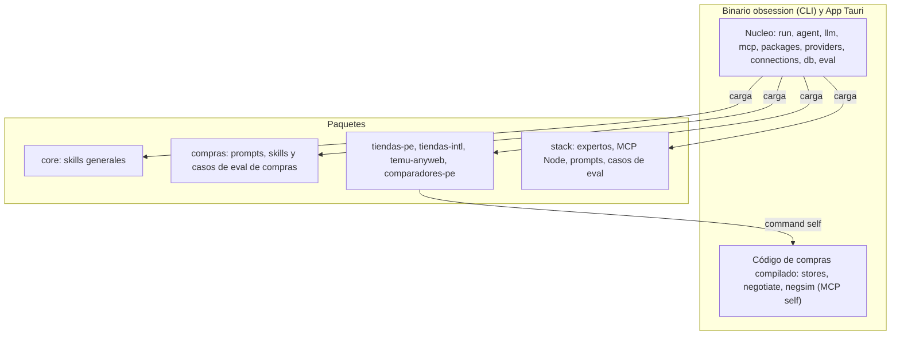
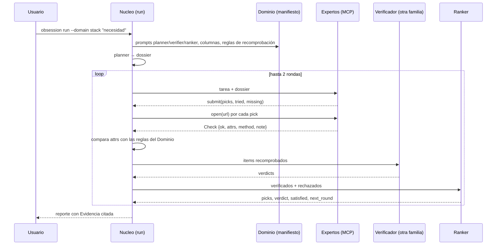

# Design Document: Hoja de ruta de Obsession (12 meses)

## Overview

Este diseño cubre dos cosas:

1. **El documento de la Hoja_de_Ruta** (`docs/ROADMAP.md`): estructura, fases, puertas, horas del Dueño, riesgos y no-objetivos. Es el entregable que piden los Requirements 1, 2, 7, 8, 9 y 10.
2. **La arquitectura técnica** que las Fases 0 a 3 tienen que construir: rutas portables de la App (Fase 0), separación del Nucleo y de Dominio_Compras (Fase 1), el Paquete_de_Dominio de Dominio_Stack (Fase 2) y el Eval_de_Dominio genérico (Fase 3). Es lo que piden los Requirements 3, 4, 5 y 6.

El diseño se apoya en el código actual:

- `src/lib.rs::run` es el bucle plan → expertos → recomprobación → verificador → ranker, con `MAX_ROUNDS = 2`, `VERIFY_BATCH = 15` y `PRICE_TOLERANCE = 0.05`. Incluye `prompts/planner.md`, `verifier.md` y `ranker.md` con `include_str!`, y trabaja con `stores::Listing` y `stores::PageCheck`, que tienen `price_pen` como campo obligatorio.
- `src/agent.rs` define `Expert`, `Skill`, el `Store` de listings, la tool `submit` y `run_expert`. Incluye `prompts/expert_harness.md`, que habla de "experto de una sola tienda" y de una tabla con precio.
- `src/packages.rs` valida `obsession-package.json` con `#[serde(deny_unknown_fields)]`, rechaza rutas con `..`, raíz o unidad, aplica `{package}` y no deja que un experto use MCP de otro paquete.
- `src/eval.rs` lee `eval/cases.json`, recomprueba cada pick con `stores::open`, pide la respuesta de un modelo sin tools y escribe `eval/results/<stamp>.{json,md}` con la línea `**Juez (mejor / igual / peor):**`.
- `app/src/main.rs::root()` usa `OBSESSION_HOME` o, si no existe, `CARGO_MANIFEST_DIR/..`. Esa es la causa de que la App no sea portable.

El lenguaje de los ejemplos es Rust (edición 2024), igual que el repo.

### Supuestos que el Dueño debe confirmar

Estos valores son propuestas. El diseño los usa, pero no están confirmados:

| Supuesto | Valor propuesto | Dónde se usa |
|---|---|---|
| A1. Duración de la Fase 4 | 1 mes. Total: 1 + 2 + 3 + 2 + 1 = 9 meses, con 3 meses de holgura para extensiones del Requirement 2.3 | Requirement 1.4 |
| A2. Tolerancia de tokens de la Fase 1 | ±10 % sobre 180 mil tokens por caso (162 mil a 198 mil) | Requirement 4.4 |
| A3. Tope de tokens de la Fase 3 | 250 mil tokens por caso en promedio | Requirement 6.3 |
| A4. Tope de tiempo de la Fase 3 | 8 de 10 casos en menos de 10 min (600 s) | Requirement 6.3 |
| A5. Horas del Dueño | Tabla de la sección "Horas del Dueño" | Requirement 9.1 |
| A6. Tolerancias de recomprobación de Dominio_Stack | Estrellas y descargas ±10 %; versión, licencia y fecha de release exactas | Afirmacion_Falsa, Requirement 6.3 |

`docs/ROADMAP.md` lleva esta tabla al principio, marcada como "por confirmar", hasta que el Dueño la apruebe.

## Architecture

### Vista general



El Nucleo no nombra ningún Dominio. Cada Paquete_de_Dominio aporta sus prompts, su formato de veredicto, sus reglas de recomprobación y sus casos de eval. El código de las tiendas sigue compilado en el binario porque los MCP de `tiendas-pe` arrancan con `command: "self"` (`obsession mcp falabella`). Eso es un servidor MCP más, no parte del Nucleo: el Nucleo solo lo ve como un proceso con tools.

### Corrida de un Dominio



### Decisiones y alternativas

| Decisión | Alternativas | Elegida y motivo |
|---|---|---|
| Separar el Nucleo | (a) workspace de Cargo con crates `obsession-core` y `obsession-compras`; (b) módulos `src/core/` y `src/compras/` en el mismo crate; (c) solo mover prompts y skills a paquetes | **(b) en la Fase 1.** Mantiene un solo binario, que es lo que exige el Requirement 1.2, y no cambia el CI. La regla "el Nucleo no importa `compras`" se comprueba con un test. Si la regla se rompe seguido, se pasa a (a) en una fase futura. (c) no basta porque `Listing` y `PageCheck` tienen `price_pen` obligatorio. |
| MCP de Dominio_Stack | (a) código Rust en el binario (`self mcp github`); (b) servidor Node empaquetado con `{package}`; (c) MCP de terceros | **(b).** El Requirement 5.5 pide instalar Dominio_Stack sin cambiar el Nucleo, y (a) obliga a recompilar. Node 24 ya es requisito de `temu-anyweb` y de `obsession install` desde npm. (c) no controla el formato de `open`. |
| Ítem genérico | (a) `Item` con `attrs: Map<String, Value>`; (b) un enum con una variante por Dominio | **(a).** (b) obliga a tocar el Nucleo por cada Dominio nuevo. |
| Dónde viven los casos de eval | (a) en `eval/` del repo; (b) dentro del paquete, en su carpeta `eval/` | **(b).** El Requirement 4.3 pide que el paquete declare sus casos, y `packages.rs` no permite rutas fuera del paquete. Los casos de compras se mueven sin cambios a `packages/compras/eval/cases.json`; la huella de casos (Property 12) demuestra que siguen siendo los mismos. Los reportes siguen en `eval/results/`. |
| Registro de puertas | (a) a mano en `docs/ESTADO.md`; (b) un comando que reescribe `ESTADO.md` | **(a), con ayuda.** El eval escribe una tabla "Puerta" en su reporte y el Dueño la copia. Reescribir un documento que el Dueño edita a mano arriesga perder sus notas. |

## Components and Interfaces

### 1. Documento `docs/ROADMAP.md`

Secciones, en este orden:

1. Supuestos por confirmar (tabla A1-A6).
2. Visión a 12 meses y criterio de cumplimiento (Requirement 1.1-1.3).
3. Tabla de fases (Requirement 1.4):

| Fase | Objetivo | Duración máx. | Meses |
|---|---|---|---|
| 0 | Cierre mínimo de Dominio_Compras | 1 mes | 1 |
| 1 | Separación del Nucleo | 2 meses | 2-3 |
| 2 | Dominio_Stack | 3 meses | 4-6 |
| 3 | Validación de Dominio_Stack | 2 meses | 7-8 |
| 4 | Decisión sobre acompañante y SaaS | 1 mes (A1) | 9 |
| — | Holgura para extensiones | 3 meses | 10-12 |

4. Una sección por fase con objetivo, entregables, Puerta_de_Fase, dependencias del Dueño y riesgos (detalle completo para las Fases 0-2, objetivo y métricas para las Fases 3-4; Requirement 1.5).
5. Horas del Dueño (Requirement 9).
6. Limitaciones y riesgos (Requirement 8).
7. No-objetivos y regla de cambio (Requirement 10).

#### Puertas de fase

| Fase | Métrica | Meta | Comprobación |
|---|---|---|---|
| 0 | Juicio_Humano de compras | 10/10 casos marcados y ≥ 7 mejor o igual | último `eval/results/<stamp>.md` |
| 0 | App portable | la App copiada fuera del repo, sin `OBSESSION_HOME`, carga `core`, `tiendas-pe`, `tiendas-intl`, `temu-anyweb` y completa una búsqueda | prueba manual descrita en `docs/ROADMAP.md` |
| 1 | Tests | `cargo test` pasa | CI |
| 1 | Línea base de compras | 10/10 sin error; picks falsos × 40 ≤ picks; tokens promedio entre 162 mil y 198 mil (A2) | `obsession eval --domain compras` |
| 1 | Negociación | 0 violaciones de límite, 0 compromisos sin checkpoint, 0 fugas | `obsession negotiate eval` |
| 1 | Nucleo sin compras | test `core_runs_a_neutral_package` pasa y `core_has_no_shopping_imports` pasa | `cargo test` |
| 2 | Paquete instalable | `obsession install packages/stack` funciona sobre el binario de la Fase 1 sin recompilar | comando |
| 2 | Corrida piloto | 3 necesidades técnicas completan con todas las afirmaciones citadas | `obsession run --domain stack` |
| 3 | Eval de Stack | 10/10 sin error; Afirmacion_Falsa × 40 ≤ afirmaciones citadas; ≤ 250 mil tokens promedio (A3); ≥ 8/10 en menos de 600 s (A4) | `obsession eval --domain stack` |
| 3 | Juicio_Humano de Stack | ≥ 7/10 mejor o igual | último `eval/results/stack-<stamp>.md` |
| 4 | Decisión escrita | documento con entradas, usuarios externos y métrica de uso (Requirement 7.2-7.3) | `docs/decisions/fase-4.md` |

La Fase 2 añade la corrida piloto como métrica propia porque el Requirement 2.1 pide una puerta medible para cada fase y la Fase 2 no tiene eval completo.

#### Horas del Dueño (supuesto A5)

| Fase | Tarea | Horas estimadas |
|---|---|---|
| 0 | Juicio_Humano de los 10 casos de compras (unos 20 min por caso) | 3-4 |
| 0 | Prueba de la App portable en una carpeta fuera del repo | 1 |
| 1 | Revisar el inventario Nucleo/Compras | 2 |
| 1 | Revisar los reportes de `obsession eval` y `negotiate eval` | 1 |
| 2 | Revisar los veredictos de la corrida piloto | 2-3 |
| 3 | Redactar o aprobar los 10 casos fijos de Dominio_Stack | 3-4 |
| 3 | Juicio_Humano de los 10 casos de Dominio_Stack (unos 30 min por caso, hay que abrir fuentes) | 5 |
| 4 | Decisión escrita | 3-4 |
| — | Reglas de negociación R1-R10 | 2 |
| — | Clave de afiliado de AliExpress | 1 |
| — | `review` y `package` de Hiraoka en AnyWeb | 1 |

Total con fase: unas 21-25 horas en 9 meses.

### 2. Rutas portables de la App (Fase 0)

Hoy `root()` sirve a la vez para leer `packages/` y para escribir `obsession.db` y `runs/`. En una instalación, la carpeta de recursos es de solo lectura, así que el diseño separa las dos rutas:

```rust
// src/lib.rs (Nucleo)
pub struct Paths {
    /// Paquetes de serie, de solo lectura.
    pub builtin: PathBuf,
    /// obsession.db, runs/ y eval/results/.
    pub data: PathBuf,
}

/// Orden: OBSESSION_HOME (las dos rutas iguales, para desarrollo) > recursos de la App > repo (solo debug).
pub fn resolve_paths(home: Option<PathBuf>, resources: Option<PathBuf>, local_app_data: Option<PathBuf>,
    repo: Option<PathBuf>) -> Option<Paths>;
```

- `app/tauri.conf.json`: `"bundle": {"resources": {"../packages": "packages"}}`.
- `app/src/main.rs`: pasa `app.path().resource_dir()` a `resolve_paths`. `repo` (la ruta `CARGO_MANIFEST_DIR/..`) solo se pasa con `cfg!(debug_assertions)`.
- `data` es `%LOCALAPPDATA%\Obsession` cuando no hay `OBSESSION_HOME`. `packages::user_dir()` ya usa esa base.
- `run`, `eval::run` y `packages::load` reciben `&Paths` en vez de `root`.

### 3. Separación del Nucleo (Fase 1)

#### Inventario

| Pieza actual | Clasificación | Destino |
|---|---|---|
| `src/lib.rs` (`run`, `pick`, `verify`, `open_pages`, `verified_listings`) | Nucleo, con partes de compras | `src/core/run.rs`. Los prompts y `price_matches` salen al Dominio. |
| `src/agent.rs` | Nucleo | `src/core/agent.rs`, con `Item` en vez de `Listing` |
| `src/llm.rs`, `src/mcp.rs`, `src/providers.rs`, `src/connections.rs` | Nucleo | `src/core/` sin cambios |
| `src/packages.rs` | Nucleo | `src/core/packages.rs`, con el bloque `domain` |
| `src/db.rs` | Nucleo, con columnas de compras | `src/core/db.rs`. `listings` guarda `attrs` como JSON; las columnas actuales se conservan para no romper `obsession.db` existentes. |
| `src/eval.rs` | Nucleo, con lógica de picks de compras | `src/core/eval.rs`. `pick_problem` pasa a ser genérico con reglas del Dominio. |
| `src/stores.rs` | Compras | `src/compras/stores.rs` (lo usan los MCP `self`) |
| `src/negotiate.rs`, `src/negsim.rs` | Compras | `src/compras/` |
| `src/main.rs` | CLI | sin mover; despacha `run --domain`, `eval --domain`, `mcp <tienda>` y `negotiate` |
| `prompts/expert_harness.md` | Nucleo, con texto de tiendas | queda en el Nucleo, reescrito sin "tienda" ni columna de precio |
| `prompts/planner.md`, `verifier.md`, `ranker.md` | Compras | `packages/compras/prompts/` |
| `prompts/negotiator.md`, `seller_sim.md`, `tone_judge.md` | Compras | `src/compras/prompts/` (los usa el código de negociación compilado) |
| skill `report-findings` | Nucleo, con ejemplos de compras ("precio, rating, ventas") | queda en `core` sin los ejemplos; los ejemplos van a la skill `report-findings-compras` |
| skill `stop-criteria` | Nucleo, con la regla 1 de compras ("dentro del presupuesto, sin señales de réplica") | queda en `core` con reglas 2 y 3 y una regla 1 genérica ("tienes al menos 2 opciones con evidencia que cumplen la necesidad"); la regla de compras va a `stop-criteria-compras` |
| skills `price-normalization`, `counterfeit-signals`, `negotiation` | Compras | `packages/compras/skills/` |
| `eval/cases.json` | Compras | `packages/compras/eval/cases.json`, sin cambios de contenido |
| `eval/negotiation_cases.json` | Compras | queda en `eval/`; lo lee `negotiate eval`, que es código de compras |

Los expertos de `tiendas-pe`, `tiendas-intl`, `temu-anyweb` y `comparadores-pe` cambian su frontmatter `skills:` a los nombres nuevos (`report-findings`, `stop-criteria`, `report-findings-compras`, `stop-criteria-compras`, `price-normalization`, `counterfeit-signals`). Las skills se pueden compartir entre paquetes (regla de `docs/packages.md`), así que esto no cambia el cargador.

Un test `core_has_no_shopping_imports` recorre `src/core/**/*.rs` y falla si encuentra `crate::compras`, `price_pen`, `stores::` o `soles`.

#### Extensión del manifiesto

`Manifest` gana un campo opcional `domain`. Los manifiestos sin `domain` siguen siendo válidos y se cargan igual que hoy.

```rust
#[derive(Debug, Deserialize)]
#[serde(deny_unknown_fields)]
pub struct Manifest {
    // ...campos actuales sin cambios...
    #[serde(default)]
    pub domain: Option<DomainSpec>,
}

#[derive(Debug, Deserialize)]
#[serde(deny_unknown_fields)]
pub struct DomainSpec {
    /// Nombre del Dominio (`compras`, `stack`): safe_name.
    pub id: String,
    /// Rutas relativas al paquete, validadas con `inside`.
    pub prompts: DomainPrompts,
    /// Columnas que `Store::table` muestra al experto, en orden. Ej.: ["price_pen", "rating", "sold"].
    pub table_columns: Vec<String>,
    /// Cómo se compara cada atributo del ítem con lo que dice la recomprobación.
    pub recheck: Vec<RecheckRule>,
    /// Ruta relativa a un JSON Schema del veredicto del ranker.
    pub verdict_schema: String,
    pub eval: Option<EvalSpec>,
}

#[derive(Debug, Deserialize)]
#[serde(deny_unknown_fields)]
pub struct DomainPrompts { pub planner: String, pub verifier: String, pub ranker: String, pub baseline: String }

#[derive(Debug, Deserialize)]
#[serde(deny_unknown_fields, tag = "kind", rename_all = "snake_case")]
pub enum RecheckRule {
    /// |página - mostrado| / mostrado <= tolerance, con mostrado > 0.
    Relative { attr: String, tolerance: f64 },
    /// Igualdad de texto tras trim y minúsculas.
    Exact { attr: String },
    /// La página dice false: el ítem se rechaza (ej. `in_stock`).
    Required { attr: String },
}

#[derive(Debug, Deserialize)]
#[serde(deny_unknown_fields)]
pub struct EvalSpec {
    pub cases: String,
    pub time_limit_s: u64,
    pub gate: Vec<GateMetric>,
}
```

Solo un paquete cargado puede declarar cada `domain.id`. Un segundo paquete con el mismo `id` choca como hoy chocan expertos y MCP (`clash`). Los paquetes sin `domain` (`core`, `tiendas-pe`) aportan expertos y skills al Dominio cuyo paquete los referencia. Para no depender del orden de instalación, `DomainSpec` no lista expertos: cada experto declara en su frontmatter `domain: compras` (por omisión `compras`, para que los expertos existentes no cambien).

Manifiesto de compras tras la Fase 1:

```json
{
  "name": "compras",
  "version": "0.2.0",
  "description": "Dominio de compras en Perú: prompts, skills y casos de eval.",
  "source": "builtin",
  "skills": ["skills/price-normalization", "skills/counterfeit-signals", "skills/negotiation",
             "skills/report-findings-compras", "skills/stop-criteria-compras"],
  "domain": {
    "id": "compras",
    "prompts": {"planner": "prompts/planner.md", "verifier": "prompts/verifier.md",
                "ranker": "prompts/ranker.md", "baseline": "prompts/baseline.md"},
    "table_columns": ["price_pen", "rating", "sold"],
    "recheck": [{"kind": "relative", "attr": "price_pen", "tolerance": 0.05},
                {"kind": "required", "attr": "in_stock"}],
    "verdict_schema": "verdict.schema.json",
    "eval": {"cases": "eval/cases.json", "time_limit_s": 300, "gate": [
      {"metric": "completed_ratio", "op": ">=", "value": 1.0},
      {"metric": "false_per_40", "op": "<=", "value": 1.0},
      {"metric": "tokens_avg", "op": "between", "value": [162000, 198000]}
    ]}
  }
}
```

`prompts/baseline.md` es el texto de la constante `BASELINE` de `eval.rs`, sacado a archivo.

#### Ítem y recomprobación genéricos

```rust
/// Lo que un experto encontró. `attrs` guarda lo específico del Dominio (price_pen, stars, license…).
#[derive(Debug, Clone, Serialize, Deserialize, PartialEq)]
pub struct Item {
    pub source: String,
    pub title: String,
    pub url: String,
    #[serde(flatten)]
    pub attrs: Map<String, Value>,
}

/// Lo que la fuente dice al reabrirla.
#[derive(Debug, Clone, Serialize, Deserialize)]
pub struct Check {
    pub url: String,
    pub ok: bool,
    #[serde(flatten)]
    pub attrs: Map<String, Value>,
    pub method: String,
    pub note: String,
}

/// None si el ítem pasa todas las reglas; Some(motivo) si no. Un bloqueo devuelve None y se cuenta aparte.
pub fn recheck_problem(item: &Item, check: &Check, rules: &[RecheckRule]) -> Option<String>;
```

`#[serde(flatten)]` hace que el JSON de `Listing` (`store`, `title`, `price_pen`, `url`, …) siga siendo válido: el MCP de las tiendas no cambia. El campo `store` se lee como `source` con `#[serde(alias = "store")]`. `PageCheck` tiene la misma forma plana, así que la tool `open` de las tiendas tampoco cambia. `price_matches` queda como `Relative { attr: "price_pen", tolerance: 0.05 }`.

`agent::anyweb_items` y `agent::text_listings` siguen en el Nucleo porque leen formatos de AnyWeb, no de compras. Producen `Item` con `price_pen` en `attrs` cuando lo encuentran.

#### Prueba de Nucleo neutral

El test `core_runs_a_neutral_package` arma en una carpeta temporal un paquete `prueba` con `domain.id = "prueba"`, un experto, un MCP falso (el propio binario de test con `self mcp fake`, que responde `search` y `open` con datos fijos) y un caso de eval. Los modelos se sustituyen por un `llm` falso detrás de una variable de entorno de test. El test comprueba que `run` termina con un pick recomprobado y que `eval` escribe un reporte con la línea de juez.

### 4. Paquete de Dominio_Stack (Fase 2)

```
packages/stack/
  obsession-package.json
  prompts/planner.md  verifier.md  ranker.md  baseline.md
  verdict.schema.json
  experts/registries.md  github.md  docs.md  benchmarks.md
  skills/evidence-citation/SKILL.md
  skills/partisan-benchmarks/SKILL.md
  skills/stop-criteria-stack/SKILL.md
  mcp/server.mjs  package.json  (Node 24, sin dependencias de scraping)
  eval/cases.json
```

#### Expertos (uno por tipo de fuente, Requirement 5.4)

| Experto | MCP | Qué busca |
|---|---|---|
| `registries` | `stack-registry` | crates.io y npm: versión, licencia, fecha del último release, descargas, dependencias directas |
| `github` | `stack-github` | repo: estrellas, issues abiertos, último commit, issues que mencionan la necesidad (por ejemplo "windows", "memory leak") |
| `docs` | `stack-docs` | página oficial de documentación: si la función que pide la necesidad existe y en qué versión |
| `benchmarks` | `stack-bench` | benchmarks publicados: resultado, autor, URL de metodología |

Los cuatro MCP son el mismo `server.mjs` con un argumento distinto, así que un experto solo ve sus propias tools (regla actual de `packages.rs`).

#### Tools MCP

| MCP | Tool | Entrada | Salida (arreglo de `Item`) |
|---|---|---|---|
| `stack-registry` | `search` | `{"query", "ecosystem": "crates"\|"npm"}` | `{source, title, url, version, license, released_at, downloads}` |
| `stack-github` | `repo` | `{"owner", "repo"}` | `{source, title, url, stars, open_issues, last_commit_at, license}` |
| `stack-github` | `issues` | `{"owner", "repo", "query"}` | `{source, title, url, state, comments, created_at}` |
| `stack-docs` | `fetch` | `{"url"}` (solo https y solo hosts de documentación declarados por la candidata en su registro) | `{source, title, url, excerpt, version_mentioned}` |
| `stack-bench` | `fetch` | `{"url"}` | `{source, title, url, author, methodology_url, result}` |
| todos | `open` | `{"url", "title"}` | `Check` con los mismos `attrs` |

`stack-github` lee `GITHUB_TOKEN` del entorno si existe (5000 peticiones por hora) y, si no, trabaja con 60 por hora. Guarda en caché por URL durante la corrida, de modo que `open` reutiliza la respuesta de `repo` cuando tiene menos de 10 minutos, y un `HTTP 403` con `X-RateLimit-Remaining: 0` se reporta con el texto `BLOCKED` del Nucleo, igual que un bloqueo de tienda. No hay reintentos con otra identidad ni evasión (Requirement 8.7).

Reglas de recomprobación de Stack (supuesto A6):

```json
"recheck": [
  {"kind": "exact", "attr": "version"},
  {"kind": "exact", "attr": "license"},
  {"kind": "exact", "attr": "released_at"},
  {"kind": "relative", "attr": "stars", "tolerance": 0.10},
  {"kind": "relative", "attr": "downloads", "tolerance": 0.10}
]
```

#### Veredicto de Stack

```json
{
  "need": "cliente HTTP async para Rust en Windows",
  "candidates": ["reqwest", "ureq", "hyper"],
  "recommendation": {"name": "reqwest", "why": "…"},
  "discarded": [{"name": "ureq", "reason": "…"}, {"name": "hyper", "reason": "…"}],
  "claims": [
    {"text": "reqwest 0.13.5 tiene licencia MIT/Apache-2.0", "evidence": [12]},
    {"text": "benchmark X: 20 % más rápido", "evidence": [31], "partisan": true}
  ],
  "satisfied": true,
  "next_round": null
}
```

- `candidates` tiene entre 2 y 5 nombres, `recommendation.name` está en `candidates` y cada otra candidata aparece en `discarded` con `reason` no vacío (Requirement 5.1).
- Cada `claims[].evidence` es una lista de ids del `Store` de la corrida.
- El Nucleo, antes de entregar el reporte, pasa los claims por `cite_claims`: un claim sin ids, con un id que no existe o con un id cuya recomprobación falló, se marca `"unsupported": true` y sale de la lista de afirmaciones del veredicto que ve el usuario, a una lista aparte "Afirmaciones sin evidencia" (Requirement 5.3).
- Un claim que cita un ítem de `stack-bench` se marca `partisan: true` si `classify_benchmark` lo dice (Requirement 5.7).

```rust
pub struct BenchmarkInfo { pub author: Option<String>, pub methodology_url: Option<String> }

/// De parte: sin URL https de metodología, o autor igual (sin mayúsculas) a una candidata o a su organización.
pub fn classify_benchmark(b: &BenchmarkInfo, candidate_owners: &[String]) -> bool;

/// Separa claims citados y recomprobados de los que no lo están.
pub fn cite_claims(claims: Vec<Claim>, checks: &HashMap<u64, Check>, rules: &[RecheckRule], store: &Store)
    -> (Vec<Claim>, Vec<Claim>);
```

`cite_claims` y `classify_benchmark` viven en el Nucleo porque sirven a cualquier Dominio con veredicto citado. Se agregan en la Fase 1 junto con el bloque `domain`, para que la Fase 2 no toque el Nucleo. Si el desarrollo de la Fase 2 encuentra que falta otra pieza en el Nucleo, se aplica el Requirement 5.6: la pieza se hace general y se vuelve a correr `obsession eval --domain compras`.

### 5. Eval de Dominio genérico (Fases 1 y 3)

`obsession eval --domain <id>` lee `domain.eval.cases` del paquete y corre el mismo método que hoy:

1. Corre `run` para cada caso.
2. Recomprueba cada pick o cada ítem citado con la tool `open` de su MCP y aplica `recheck_problem`.
3. Pide la respuesta de un modelo sin tools con `prompts.baseline`.
4. Escribe `eval/results/<domain>-<stamp>.json` y `.md` con la tabla de resumen, una sección por caso, la respuesta sin tools al lado y la línea `**Juez (mejor / igual / peor):** `.
5. Escribe al final del `.md` una tabla "Puerta" con cada métrica de `eval.gate`, su valor y si cumple.
6. Escribe en el `.json` la huella de los casos (`cases_sha256`, SHA-256 del archivo de casos) y el modelo de cada rol.

Para compras, el nombre del reporte sigue siendo `<stamp>.md` hasta que termine la Fase 1, para no romper la comparación con los reportes de `eval/results/` actuales; después pasa a `compras-<stamp>.md`.

Casos de Dominio_Stack (`packages/stack/eval/cases.json`):

```json
{
  "note": "Casos fijos. Cambiarlos rompe la comparación entre corridas.",
  "cases": [
    {"id": "rust-http-async",
     "need": "cliente HTTP async para un CLI en Rust que corre en Windows",
     "expected_candidates": ["reqwest", "ureq", "hyper"],
     "constraints": {"language": "rust", "license": "MIT o Apache-2.0", "platform": "windows"}}
  ]
}
```

El Dueño redacta o aprueba los 10 casos (Requirement 9.2). Cada caso tiene `need`, `expected_candidates` (2 a 5) y `constraints` con `language`, `license` y `platform`.

Métricas del resumen de Stack:

| Campo | Definición |
|---|---|
| `cases`, `completed` | como hoy |
| `under_limit` | completados con `elapsed_s <= time_limit_s` (600 para Stack, supuesto A4) |
| `claims` | afirmaciones citadas en los veredictos |
| `false_claims` | afirmaciones cuya recomprobación en el eval da problema, o que el Nucleo marcó sin evidencia |
| `blocked_claims` | afirmaciones cuya fuente bloqueó al recomprobar (no cuentan como falsas) |
| `tokens_avg` | tokens totales / casos completados |

Puerta de la Fase 3 en el manifiesto de Stack:

```json
"gate": [
  {"metric": "completed_ratio", "op": ">=", "value": 1.0},
  {"metric": "false_per_40", "op": "<=", "value": 1.0},
  {"metric": "tokens_avg", "op": "<=", "value": 250000},
  {"metric": "under_limit", "op": ">=", "value": 8}
]
```

`false_per_40` es `false_claims * 40 / claims`. Si `claims` es 0, la métrica no cumple: un eval sin afirmaciones no demuestra nada.

```rust
#[derive(Debug, Deserialize)]
pub struct GateMetric { pub metric: String, pub op: GateOp, pub value: Value }

/// Lista las métricas que no cumplen, con valor y meta. Vacía = la puerta pasa.
pub fn gate(summary: &Value, metrics: &[GateMetric]) -> Vec<GateMiss>;

/// Marcas del juez leídas del reporte .md, en orden de caso.
pub fn judge_marks(md: &str) -> Vec<(String, Option<Mark>)>;
```

El Juicio_Humano no entra en `gate` porque se escribe después de correr el eval. `obsession eval judge <reporte.md>` lee las marcas con `judge_marks`, cuenta mejor, igual y peor e imprime si se llega a 7 de 10. Junto al resultado imprime "Juicio de un solo juez" (Requirement 8.6).

### 6. Registro de puertas en `docs/ESTADO.md`

`docs/ESTADO.md` gana una sección fija:

```markdown
## Puertas de fase

| Fase | Métrica | Meta | Resultado | Fecha | Comprobación | Estado |
|---|---|---|---|---|---|---|
| 0 | Juicio_Humano compras | ≥ 7/10 mejor o igual | 8/10 (un solo juez) | 2026-12-05 | eval/results/1795157191.md | cumplida |
| 0 | App portable | carga 4 paquetes y busca | — | — | prueba manual de ROADMAP.md | en curso |

### Desvíos

| Fecha | Fase | Métrica no cumplida | Causa conocida | Decisión |
|---|---|---|---|---|

### Bloqueos del Dueño (más de 2 semanas)

| Desde | Tarea | Puerta que bloquea |
|---|---|---|
```

- `Estado` toma uno de tres valores: `en curso`, `cumplida`, `no cumplida`.
- `Decisión` toma uno de tres valores: `extender`, `recortar alcance`, `cambiar meta` (Requirement 2.3).
- Una fase empieza solo cuando todas las filas de la fase anterior dicen `cumplida`, o cuando hay una fila de Desvíos con decisión (Requirements 2.2, 3.4 y 4.7).
- El Dueño copia las filas de la tabla "Puerta" del reporte de eval. Nada reescribe `ESTADO.md` de forma automática.

### 7. Riesgos y mitigaciones (Requirement 8)

| Riesgo | Mitigación | Fase |
|---|---|---|
| La separación del Nucleo degrada compras | `obsession eval --domain compras` y `negotiate eval` son parte de la puerta; el refactor va en PRs chicos, uno por fila del inventario | 1 |
| Un solo juez sesga "mejor" | se imprime "un solo juez" junto a cada resultado; el Dueño anota en cada caso dudoso qué fuente abrió | 0, 3 |
| Documentación que cambia entre versiones | cada claim de docs guarda `version_mentioned`; el ranker compara con la versión del registro | 2 |
| Límite de la API de GitHub (60/h sin token, 5000/h con token) | `GITHUB_TOKEN` opcional guardado con `obsession key` (DPAPI); caché por URL en la corrida; un 403 por límite se reporta como bloqueo | 2, 3 |
| Benchmarks de parte o viejos | `classify_benchmark`; el verificador marca `desactualizado` si el benchmark es de una versión mayor anterior a la actual | 2 |
| Casos de eval cuya respuesta cambia con el tiempo | el reporte guarda fecha, `cases_sha256` y las versiones vistas; el juez compara con lo que era cierto ese día; los casos no se editan entre corridas comparadas | 3 |
| App portable falla en otra PC | prueba manual de la puerta 0 en una carpeta fuera del repo y sin `OBSESSION_HOME` | 0 |
| Solo Windows (DPAPI, programador de tareas, toasts) | se declara como límite; ninguna fase de 12 meses lo cambia | — |
| magpie como proveedor por defecto; BYOK sin probar | se declara como límite; la Fase 4 lo pesa si se buscan usuarios externos | 4 |
| Amazon, AliExpress y Temu bloquean sin navegador; AliExpress cambia precios | se mantiene el reporte de bloqueo; sin evasión anti-bot en ningún Dominio | todas |
| Un solo desarrollador | holgura de 3 meses (A1); fases con alcance que se puede recortar | todas |

### 8. No-objetivos y regla de cambio (Requirement 10)

`docs/ROADMAP.md` lista como no-objetivos: acompañante, SaaS, búsqueda activa de usuarios externos, poller remoto del watch (PR 4 de `docs/design/watch.md`), negociación autónoma en plataformas reales y un tercer Dominio. Lista como pendientes de compras fuera de las Fases 0-3: watch PR 1-3, panel de negociación (PR 4 de `docs/design/negotiation.md`), tono de negociación, conector de AliExpress y fuentes nuevas.

Para agregar trabajo de esa lista, el Dueño escribe en `docs/ROADMAP.md` una fila en "Cambios" con fecha, trabajo que entra, Fase afectada y trabajo que sale.

## Data Models

| Modelo | Dónde | Campos |
|---|---|---|
| `Paths` | `src/core/` | `builtin`, `data` |
| `DomainSpec` | `obsession-package.json` → `domain` | `id`, `prompts`, `table_columns`, `recheck`, `verdict_schema`, `eval` |
| `RecheckRule` | `domain.recheck[]` | `relative {attr, tolerance}`, `exact {attr}`, `required {attr}` |
| `EvalSpec` | `domain.eval` | `cases`, `time_limit_s`, `gate[]` |
| `GateMetric` | `domain.eval.gate[]` | `metric`, `op` (`>=`, `<=`, `between`), `value` |
| `Item` | `src/core/agent.rs` | `source` (alias `store`), `title`, `url`, `attrs` |
| `Check` | `src/core/` | `url`, `ok`, `attrs`, `method`, `note` |
| `Claim` | veredicto de Stack | `text`, `evidence: [u64]`, `partisan`, `unsupported` |
| Caso de Stack | `packages/stack/eval/cases.json` | `id`, `need`, `expected_candidates`, `constraints {language, license, platform}` |
| Reporte de eval | `eval/results/<domain>-<stamp>.json` | `summary`, `rows`, `cases_sha256`, `models`, `gate` |
| Fila de puerta | `docs/ESTADO.md` | `fase`, `métrica`, `meta`, `resultado`, `fecha`, `comprobación`, `estado` |

Migración de `obsession.db`: se agrega la columna `attrs TEXT` a `listings`. Las filas viejas la tienen en `NULL` y se leen con sus columnas actuales. Antes de migrar se copia el archivo a `obsession.db.bak`.

## Error Handling

| Situación | Comportamiento |
|---|---|
| Manifiesto con `domain` mal formado o con rutas fuera del paquete | el paquete no carga y sale un aviso, como hoy con cualquier error de `read` |
| Dos paquetes con el mismo `domain.id` | el segundo no carga; aviso «choca con un paquete ya cargado: dominio «…»» |
| `--domain` desconocido | error con la lista de Dominios cargados |
| Prompt del Dominio que no existe | el paquete no carga |
| Ranker devuelve un veredicto que no cumple `verdict_schema` | en ronda 1, error de la corrida; en ronda 2, se mantiene la decisión anterior (igual que hoy) |
| Fuente bloqueada o límite de GitHub | se reporta con `BLOCKED`; el experto entrega antes de tiempo; en el eval el ítem cuenta como `blocked`, no como falso |
| Claim sin evidencia | sale del veredicto principal a "Afirmaciones sin evidencia"; en el eval cuenta como falso |
| `claims = 0` en el eval | la métrica `false_per_40` no cumple |
| Archivo de casos cambiado entre dos reportes | `obsession eval compare` se niega a comparar y muestra las dos huellas |
| La App no encuentra recursos ni `OBSESSION_HOME` en release | error visible en la App: "no encuentro los paquetes de serie", sin caer al repo |

## Correctness Properties

*A property is a characteristic or behavior that should hold true across all valid executions of a system-essentially, a formal statement about what the system should do. Properties serve as the bridge between human-readable specifications and machine-verifiable correctness guarantees.*

Los criterios sobre el contenido de `docs/ROADMAP.md`, el proceso del Dueño y la decisión de la Fase 4 (Requirements 1.1, 1.3, 1.5, 2.4, 3.1, 3.2, 3.6, 3.7, 4.1, 4.8, 5.2, 5.4, 5.8, 6.7, 7, 8.1-8.6, 9 y 10) no son computables: se revisan a mano. Las propiedades cubren el código que esas fases construyen.

### Property 1: Los manifiestos actuales siguen cargando igual

*For any* manifiesto válido sin campo `domain`, el lector nuevo lo acepta y produce los mismos expertos, skills, servidores MCP y requisitos que el lector actual; y *for any* manifiesto con un campo desconocido en la raíz o dentro de `domain`, el lector lo rechaza.

**Validates: Requirements 4.3, 4.4**

### Property 2: Las rutas del Dominio no salen del paquete

*For any* ruta declarada en `domain.prompts`, `domain.verdict_schema` o `domain.eval.cases` que contenga `..`, `.`, una raíz, una unidad o esté vacía, el paquete se rechaza; y *for any* ruta hecha solo de componentes normales, el archivo resuelto está dentro de la carpeta del paquete.

**Validates: Requirements 4.3, 5.5**

### Property 3: Ida y vuelta Listing ↔ Item

*For any* `Listing` válido, serializarlo a JSON, leerlo como `Item` y volver a escribirlo como `Listing` da un valor igual al original; y *for any* `PageCheck`, leerlo como `Check` conserva `ok`, `url`, `method`, `note` y cada atributo presente.

**Validates: Requirements 4.2, 4.4**

### Property 4: La regla relativa reproduce `price_matches`

*For any* par de precios `(mostrado, página)` con `página` presente o ausente, `recheck_problem` con la regla `Relative { attr: "price_pen", tolerance: 0.05 }` da `None` si y solo si `price_matches(mostrado, página)` es verdadero; y *for any* tolerancia `t ≥ 0` y valores `s > 0`, la regla acepta exactamente cuando `|p - s| / s ≤ t`.

**Validates: Requirements 4.4, 6.3**

### Property 5: Un bloqueo nunca cuenta como falso

*For any* ítem y *for any* `Check` con `ok = false` y nota que contiene `BLOCKED`, `recheck_problem` devuelve `None` y el eval lo cuenta en `blocked`/`blocked_claims`, nunca en picks falsos ni en `false_claims`.

**Validates: Requirements 4.4, 6.3, 8.7**

### Property 6: Solo llegan al veredicto afirmaciones con evidencia recomprobada

*For any* lista de claims, `Store` y mapa de checks, cada claim que `cite_claims` deja en el veredicto cita al menos un id que existe en el `Store`, cuya URL es https y cuya recomprobación dio `ok` sin problema; cada claim que no cumple eso queda en la lista de sin evidencia; y la unión de ambas listas es la lista de entrada, sin pérdidas ni duplicados.

**Validates: Requirements 5.3**

### Property 7: Benchmarks de parte

*For any* benchmark y lista de dueños de candidatas, `classify_benchmark` devuelve verdadero si y solo si no hay URL https de metodología o el autor, sin distinguir mayúsculas, coincide con uno de los dueños.

**Validates: Requirements 5.7**

### Property 8: Forma del veredicto de Stack

*For any* veredicto, el validador lo acepta si y solo si `candidates` tiene entre 2 y 5 nombres distintos, `recommendation.name` está en `candidates` y cada otra candidata aparece exactamente una vez en `discarded` con `reason` no vacío.

**Validates: Requirements 5.1**

### Property 9: La puerta pasa si y solo si todas las métricas cumplen

*For any* resumen de eval y lista de métricas de puerta, `gate` devuelve exactamente las métricas cuyo valor no cumple su operador (vacía si y solo si todas cumplen); y *for any* resumen que pasa, mejorar una métrica (más casos completados, menos falsos, menos tokens bajo un tope `<=`) no hace que la puerta falle.

**Validates: Requirements 1.2, 2.2, 2.3, 3.4, 4.4, 4.7, 6.3, 6.5**

### Property 10: Invariantes del resumen de eval

*For any* conjunto de filas de eval, el resumen cumple `completed ≤ cases`, `under_limit ≤ completed`, `false + blocked ≤ picks` (o `false_claims + blocked_claims ≤ claims`), y `false_per_40` es `false * 40 / total` cuando `total > 0` y no cumple cuando `total = 0`.

**Validates: Requirements 4.4, 6.3**

### Property 11: Ida y vuelta de las marcas del juez

*For any* conjunto de filas de eval y *for any* asignación de marcas mejor, igual, peor o vacía por caso escrita en la línea `**Juez (mejor / igual / peor):**` del reporte generado, `judge_marks` devuelve, en orden, el id de cada caso con su marca; y el conteo "mejor o igual ≥ 7" coincide con el de las marcas asignadas.

**Validates: Requirements 3.3, 6.2, 6.4**

### Property 12: No se comparan corridas con casos distintos

*For any* par de archivos de casos, `compare` acepta dos reportes solo si sus `cases_sha256` son iguales; y *for any* cambio en el id, la consulta o la necesidad de un caso, la huella cambia.

**Validates: Requirements 6.6**

### Property 13: Resolución de rutas de la App

*For any* combinación de `OBSESSION_HOME`, carpeta de recursos, `LOCALAPPDATA` y modo de compilación, `resolve_paths` elige `OBSESSION_HOME` si existe, si no los recursos, y usa el repo solo en debug; y *for any* resultado con recursos, `data` no está dentro de `builtin`.

**Validates: Requirements 3.5**

## Testing Strategy

### Tests de propiedades

- Librería: `proptest` como `dev-dependency` del crate raíz. Es una dependencia nueva; solo se compila en tests.
- Cada property test corre al menos 100 casos (`ProptestConfig { cases: 100, .. }`).
- Cada test lleva un comentario con la etiqueta `Feature: product-roadmap, Property N: <título>`.
- Generadores: manifiestos con campos de `docs/packages.md` y rutas con componentes aleatorios (incluidos `..`, `C:`, `/`); `Listing` con títulos Unicode y precios positivos; claims con ids existentes, inexistentes y bloqueados; resúmenes con valores en los bordes de cada umbral (162 000, 198 000, 250 000, 600 s, 1 falso en 40).
- Las propiedades 1-13 son funciones puras o casi puras (escriben solo en carpetas temporales), así que corren en el CI actual sin red ni modelos.

### Tests de ejemplo y de humo

| Test | Tipo | Requirement |
|---|---|---|
| `core_runs_a_neutral_package`: paquete de prueba con MCP y LLM falsos | ejemplo | 4.6 |
| `core_has_no_shopping_imports`: grep sobre `src/core/` | humo | 4.6 |
| `repo_packages_load_every_builtin_expert` (ya existe) actualizado con el paquete `compras` y `stack` | ejemplo | 4.2, 5.5 |
| core no tiene skills de compras; `compras` sí | ejemplo | 4.2 |
| `obsession install packages/stack` en una carpeta temporal de usuario | ejemplo | 5.5 |
| `packages/stack/eval/cases.json` tiene 10 casos con `need`, 2-5 `expected_candidates` y `constraints` | ejemplo | 6.1 |
| suma de duraciones de `docs/ROADMAP.md` ≤ 12 | ejemplo | 1.4 |

### Integración (manual o fuera del CI)

- `obsession eval --domain compras` y `obsession negotiate eval` antes de cerrar la Fase 1 (unos 30 min cada uno, con modelos reales).
- Prueba de la App portable de la Fase 0.
- `obsession eval --domain stack` en la Fase 3, con y sin `GITHUB_TOKEN`.
